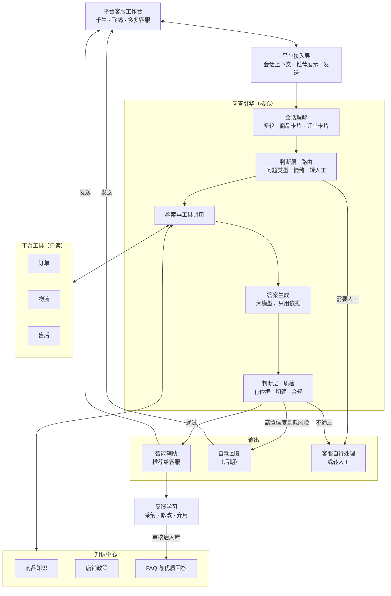
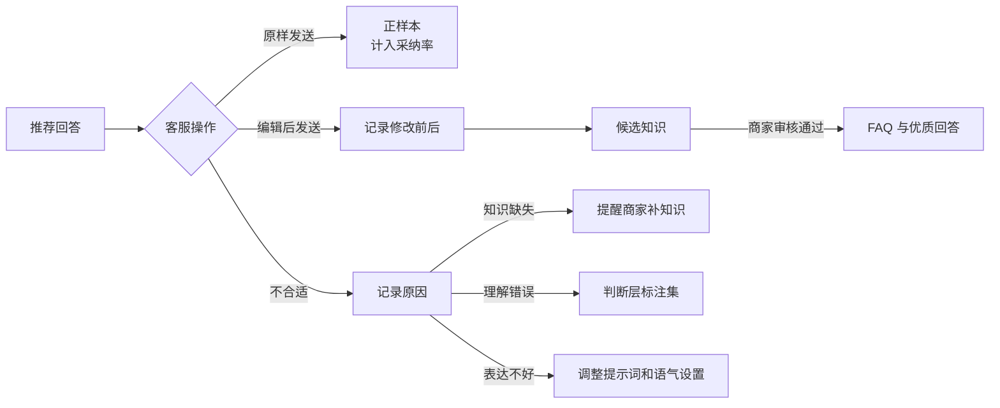
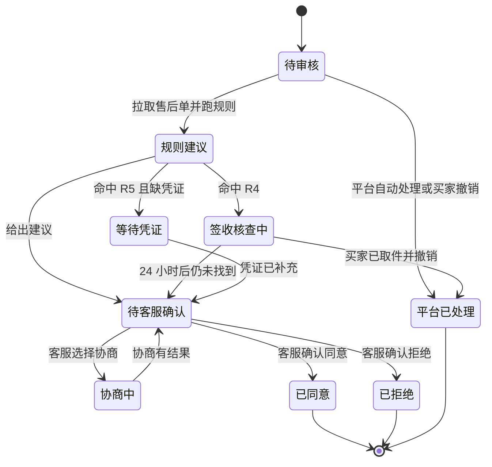
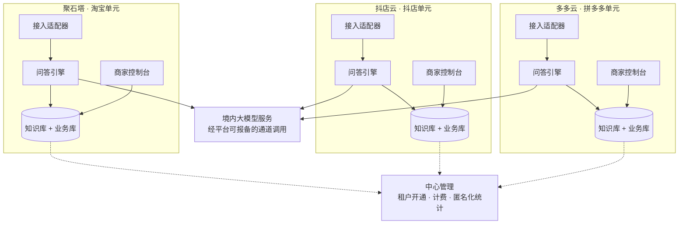
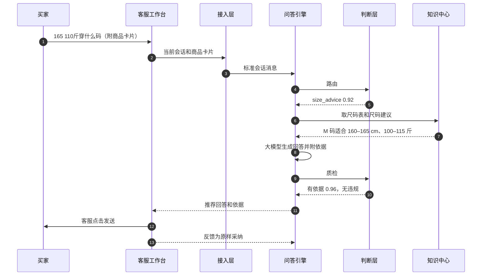
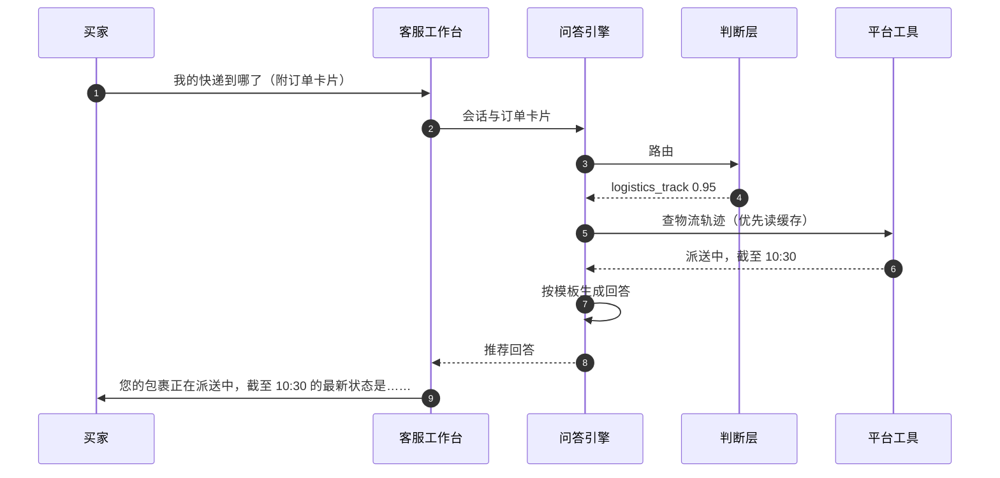
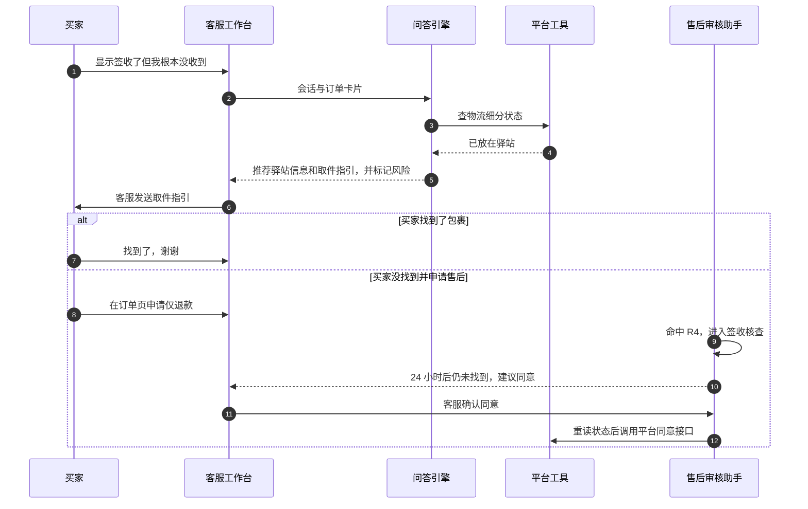

# 电商平台商家 AI 客服方案（淘宝 / 抖店 / 拼多多）

> 版本：v0.2（草案） ｜ 日期：2026-09-28 ｜ 状态：待评审
>
> **定位**：为淘宝/天猫、抖店、拼多多上的商家提供 AI 客服。**核心是回答买家的售前和售后问题**；查订单、查物流、处理售后，都是回答问题时调用的工具。
>
> **标记说明**
> - 【待决策】需要你拍板；【待确认】需要向平台、供应商或法务确认；【待实测】需要拿到数据后替换。
> - 来源可信度：【已核实】官方原文；【较可信】知名服务商资料，或多个来源一致；【推断】根据现有资料推断。
> - 每个设计旁边都附了"优势 / 劣势"，方便逐块评审。

---

## v0.2 相对 v0.1 的主要变化

| 项目 | v0.1 | v0.2 | 原因 |
|---|---|---|---|
| 服务对象 | 泛指"用户"，分散在多个渠道 | 淘宝、抖店、拼多多上的商家；每个买家只在一个平台、一个店铺内咨询 | 按你的定位修改 |
| 核心 | 客服、退款、快递三件事并列 | **回答买家问题**是主体；订单、物流、售后是工具 | 按你的定位修改 |
| 问题范围 | 以物流和退款为主 | 售前 + 售后全部 | 按你的定位修改 |
| 渠道 | WhatsApp、微信客服、自建网页 | 千牛、飞鸽、多多客服（各平台的客服工作台） | — |
| 身份映射 | 跨渠道映射，是最大风险之一 | 基本取消：买家和订单都在同一个平台内 | 买家不会跨平台咨询 |
| 回复窗口 | 24 小时 / 48 小时窗口管理 | 删除；改为关注平台客服考核指标 | — |
| 接入模式 | 默认全自动 | MVP 为**智能辅助**（AI 起草、客服发送），全自动放到后期 | 平台开放能力和考核规则，见第 2 节 |
| 判断层 | 直接调用 Jev | 保留 Jev 的接口格式；生产链路先用境内、平台云内的实现 | 数据合规和中文效果，见第 6 节 |
| 退款 | 调微信支付 / 支付宝接口退款 | 平台售后单：买家发起，商家经平台接口同意或拒绝 | 钱在平台内流转 |
| 物流数据 | 快递100 / 17TRACK | 优先用平台开放接口 | 数据不出平台云 |
| 部署 | 单一系统 | 每个平台云各部署一个单元，另有中心控制台 | 平台数据安全规则 |
| 新增内容 | — | 平台约束调研、知识中心、答案质检、反馈闭环、多租户、平台准入 | — |

---

## 目录

0. [一页摘要](#0-一页摘要)
1. [背景、定位与目标](#1-背景定位与目标)
2. [平台约束（调研结论）](#2-平台约束调研结论)
3. [前提假设与待决策](#3-前提假设与待决策)
4. [总体架构](#4-总体架构)
5. [问答引擎（核心）](#5-问答引擎核心)
6. [判断层与 Jev](#6-判断层与-jev)
7. [工具能力：订单、物流、售后](#7-工具能力订单物流售后)
8. [平台接入层](#8-平台接入层)
9. [多租户与部署](#9-多租户与部署)
10. [数据模型](#10-数据模型)
11. [核心流程](#11-核心流程)
12. [非功能设计](#12-非功能设计)
13. [评估与校准](#13-评估与校准)
14. [成本估算框架](#14-成本估算框架)
15. [实施路线图](#15-实施路线图)
16. [风险清单](#16-风险清单)
17. [附录](#17-附录)

---

## 0. 一页摘要

**做什么**：一套给淘宝、抖店、拼多多商家用的 AI 客服。买家在店铺里问任何问题，比如尺码、材质、发货、物流、退换、退款，系统根据商品知识、店铺政策和实时订单数据，几秒内给出有依据的回答。

**核心思路：把"回答一个问题"拆成五步**

| 环节 | 由谁负责 | 一句话 |
|---|---|---|
| 懂问题 | 判断层（路由） | 这是什么问题、需要哪些依据、要不要转人工 |
| 找依据 | 知识中心 + 工具 | 商品知识、店铺政策，加上订单、物流、售后的实时数据 |
| 写回答 | 大模型 | 只根据找到的依据写；依据里没有的，不猜 |
| 把关 | 判断层（质检）+ 规则 | 回答是否有依据、是否答非所问、是否违反平台规则 |
| 兜底 | 人工客服 | 拿不准的交给人；售后操作必须由人确认 |

**调研后最重要的三个发现（它们决定了架构）**

1. **全自动接待很难拿到**：淘宝有"客服机器人"等官方类目，但准入严格；抖店和拼多多没有查到第三方全自动收发消息的公开接口。三个平台都能走通的是**智能辅助**：AI 起草回答，客服一键发送。而且在淘宝和抖店，这种由人工发出的回复计为人工回复，反而能改善平台的客服考核指标。
2. **数据必须留在平台云里**：淘宝要求客户服务类应用入驻聚石塔，拼多多的订单和售后接口要在多多云内调用，抖店有抖店云。所以每个平台要单独部署一份。
3. **Jev 暂时不能放进生产链路**：买家消息发给 Jev 后会流向境外处理方，这和平台"不得转委托他人处理个人信息"的规则、以及个人信息出境的法律要求都冲突；Jev 官方也说明英语之外的语言"效果较不稳定"。方案保留 Jev 的判断接口格式，生产上先用境内实现，满足条件后可以直接换回 Jev。

**整体优势**

- 以问答为核心，售前售后用同一套引擎，商家最能直接感受到价值。
- 智能辅助模式合规、风险低，还能帮商家改善"人工响应"类考核指标。
- 判断层的接口与 Jev 保持一致，将来条件满足可以直接切换。
- 知识中心加采纳反馈形成闭环，用得越多答得越准。

**整体劣势**

- 平台准入是第一道坎，部分类目的门槛可能高于小公司当前的条件（见 2.3）。
- 三个平台就是三套云、三套接入，工程和运维成本大约是单平台的两到三倍。
- MVP 阶段仍然需要人工坐席，节省的是打字和查询的时间，不是人头。
- 要和平台官方的 AI 客服（店小蜜、飞鸽智能客服等）直接竞争。

**MVP 建议**：先选一个平台，做智能辅助：售前问答、物流问答、售后政策问答；售后审核只给建议。先用影子模式跑，再开放给客服使用。

---

## 1. 背景、定位与目标

### 1.1 产品定位

- **服务对象**：淘宝/天猫、抖店、拼多多上的商家。我们是第三方服务商。
- **使用者**：商家的客服人员（智能辅助模式）；后期部分问题由系统自动回复。
- **最终受益者**：店铺的买家，能更快、更准地得到回答。
- **一个关键事实**：一个买家的一次咨询只发生在一个平台、一个店铺内。系统不需要跨平台识别同一个人，买家的订单也都能在同一个平台里查到。

### 1.2 本质：回答买家的问题

商家客服每天回答的问题大致分三类（详细分类见 5.1）：

| 阶段 | 典型问题 | 回答需要的依据 |
|---|---|---|
| 售前 | 这个是纯棉的吗？165 cm、110 斤穿什么码？什么时候发货？有优惠吗？ | 商品知识、尺码表、店铺政策、活动配置、库存 |
| 售中 | 我的快递到哪了？怎么还没发货？能改地址吗？ | 订单、物流轨迹、店铺政策 |
| 售后 | 能退吗？运费谁出？退款什么时候到？收到的东西坏了怎么办？ | 店铺政策、订单、售后单状态 |

每个店铺的问题分布不一样。Phase 0 会用种子商家的真实咨询统计分布，决定先把哪几类问题做到最好。

### 1.3 目标（建议值，上线后按真实数据校准）

| 指标 | 目标 | 说明 |
|---|---|---|
| 回答准确率（人工抽检） | ≥ 95% | 事实正确、没有答非所问 |
| 推荐采纳率（智能辅助） | ≥ 60% | 客服原样发送或小改后发送的比例，是智能辅助模式的核心指标 |
| 推荐答案出现时间 P95 | ≤ 5 秒 | 太慢的话，客服就自己打字了 |
| 平台话术违规 | 0 | 站外引流、绝对化用语、虚假承诺 |
| 平台客服指标 | 较接入前改善 | 淘宝：3 分钟人工响应率；抖店：飞鸽平均响应时长、会话不满意率、售后平均审核时长；拼多多：3 分钟人工回复率 |
| 售后误操作 | 0 | 不错误地同意或拒绝售后 |
| 自动回复准确率（后期全自动） | ≥ 98% | 只对高置信度、低风险的问题类型开放 |

### 1.4 非目标

- 营销群发、主动拉新、任何站外引流。
- 替买家发起售后（平台只允许买家发起）。
- 用 RPA、模拟登录、逆向客户端、抓包等方式绕过平台开放接口。
- MVP 阶段不做：全自动接待、图片和视频理解、跨境平台。

---

## 2. 平台约束（调研结论）

三个平台的开放能力、数据规则和考核方式，直接决定了能怎么接、数据放在哪、AI 能做到哪一步。以下是公开资料的调研结果。部分官方页面抓不到正文，这些结论在 Phase 0 需要向平台逐条确认。

### 2.1 三平台对比

| 项目 | 淘宝 / 天猫 | 抖店 | 拼多多 |
|---|---|---|---|
| 客服工作台 | 千牛（旺旺） | 飞鸽 | 多多客服 |
| 第三方接入路径 | 服务市场有"客服机器人"类目；"客服面板插件"包含人机协同接待；另有"AI 智能体-人机接待"类目【已核实】 | 没有查到公开的飞鸽消息收发接口；官方扩展方式是在飞鸽"客服工具"里启用服务市场插件【较可信】；头部服务商的抖音机器人只支持智能辅助模式【较可信】 | 没有查到面向商家服务商的客服消息开放接口；现有方案多依赖 RPA 或模拟商家后台【较可信】 |
| 数据部署要求 | 客户服务类应用必须入驻聚石塔；订单和会员数据要存在 RDS；与塔外系统交互须提交场景和字段说明，审核通过后走奇门接口；高风险写接口必须在塔内调用【已核实】 | 订单敏感信息要调用解密接口，有额度限制【已核实，仅标题】；微应用须部署在抖店云；接口按云内 / 云外分档收费【推断，2023 年资料】 | 订单、售后、解密等敏感接口须在多多云内调用；云主机出网要开通出云访问（EGW）【较可信，单一来源】 |
| 个人信息规则 | 不得超出授权范围使用，不得转委托他人处理；跨境传输须完成评估【已核实】 | 没有查到平台条款；法律层面，个人信息出境须告知、取得单独同意、做影响评估【已核实（法规）】 | 没有查到平台条款 |
| 售后规则 | 由买家发起；同意退款要子账号有权限，默认还要短信验证；2025-10-15 起部分场景须先协商才能拒绝；拒绝率明显偏高的商家会被阻断拒绝接口【已核实】 | 由买家发起；商家可通过接口同意或拒绝，拒绝要传原因码【较可信】 | 由买家发起；有同意退款、同意退货接口；拒绝接口没有查到【较可信】 |
| 客服考核 | "真实体验分"含旺旺 3 分钟人工响应率等【较可信】；全自动机器人的回复不计入，智能辅助模式下由人工发出的回复计入【较可信】 | 商家体验分（2026-07-14 新版）服务维度包括飞鸽平均响应时长、会话不满意率、平台求助率、售后平均审核时长【较可信】；智能辅助推荐由人工发出算人工回复，全自动不算【较可信】 | 3 分钟人工回复率，考核 8:00–23:00，机器人回复不计入【较可信】 |
| 官方 AI 客服 | 店小蜜；机器人配置里官方和第三方二选一【较可信】 | 飞鸽智能客服：答不了会自动转人工，商家必须配人工客服【已核实】 | 多多客服内置机器人回复设置【较可信】 |
| 话术禁区 | 应用发出的消息须符合《广告法》等法规【已核实】；站外引流条款原文没有查到 | 禁止发送或索要微信、手机号、收款码、站外链接，违规扣分并可能被限制使用飞鸽【较可信】 | 禁止站外收付款、交换第三方账号或手机号、引导下载站外应用【较可信】 |

### 2.2 对架构的五条硬约束

1. **接入以智能辅助为主。** 三个平台里只有淘宝有明确的第三方机器人类目；即使拿到了，全自动回复也不计入人工响应率。AI 起草、客服发送，是三个平台都能走通、而且对商家考核指标有利的模式。
2. **每个平台一个部署单元。** 处理订单和买家数据的服务，部署在对应的平台云里（聚石塔 / 抖店云 / 多多云），数据不跨云流动。
3. **模型调用留在境内，而且走可报备的通道。** 大模型和判断模型都用境内服务，调用路径要能通过平台审核（淘宝要求报备塔外交互）。**【待确认】** 各平台云内调用外部大模型 API 的具体要求。
4. **售后只能"系统建议、人来确认"。** 售后由买家发起，商家通过接口同意或拒绝；淘宝的同意接口本身就要权限和短信验证，拒绝前还有协商要求和拒绝率限制。
5. **每条回复都要过平台话术规则。** 发出前检查站外引流、绝对化用语、虚假承诺。

### 2.3 准入门槛

| 路径 | 已知门槛 | 来源与时效 |
|---|---|---|
| 淘宝"客服机器人"类目 | 限量优选，保证金 5 万元 | 2020 年公示，可能已更新【已核实】 |
| 淘宝"客服面板插件" | 注册资本 ≥ 500 万元，公司 ≥ 300 人 | 【已核实】 |
| 淘宝"AI 智能体-人机接待"类目 | 以 AI 应用开发商身份入驻并通过审核；该类目的知识库 API 禁止外部调用 | 【已核实】 |
| 抖店客服工具类微应用 | 只接受企业入驻，要有软著；注册资本 ≥ 100 万元、成立 ≥ 1 年；部署在抖店云 | 2023 年知乎资料【推断】 |
| 拼多多 | 应用要依次通过资质审核、安全扫描、上线审核；客服消息能力没有查到 | 【较可信】 |

对新成立、规模小的公司来说，这些门槛可能是第一道坎。可以并行准备四条路：

1. **自主申请**：先挑门槛最低、最匹配的类目（例如淘宝"AI 智能体-人机接待"）。
2. **与已有资质的客服服务商合作**：作为他们的 AI 能力供应方。
3. **商家自研 / 自用型应用**：部分平台允许商家为自己的店铺开发应用，门槛可能不同。**【待确认】**
4. **过渡期用独立话术助手**：不接平台接口，先验证问答质量（见 8.1 模式 C）。

### 2.4 明确不采用的接入方式

RPA、模拟登录、逆向客户端、抓包，一律不用。

- 淘宝应用安全规范禁止"通过任何爬虫和插件等手段……获取……用户数据"【已核实】。
- 平台会清退违规服务商，淘宝 2025 年 12 月公示清退了 11 家【已核实】。
- 商家店铺会因此被扣分甚至封店，这是商家最不能接受的风险。

| 优势 | 劣势 |
|---|---|
| 合规，商家敢用，平台不会封 | 接入速度受平台准入节奏影响 |
| 接口稳定，不会因为平台改版失效 | 部分平台（拼多多、抖店）短期内可能只能做很浅的集成 |

---

## 3. 前提假设与待决策

本方案先按"默认"一列来写，你确定后我再改对应章节。

| # | 决策项 | 本方案默认 | 备选 | 影响的章节 |
|---|---|---|---|---|
| D1 | **【待决策】** 首发平台 | 以"最先拿到准入的平台"为准；产品核心做成平台无关 | 指定淘宝 / 抖店 / 拼多多 | 8、9、15 |
| D2 | 接入模式 | MVP 做智能辅助；全自动放到后期，先在淘宝尝试 | 一开始就申请全自动 | 5.6、8 |
| D3 | **【待决策】** 准入路径 | 自主申请，同时接触一家持证服务商 | 只走合作 / 商家自研 / 先做独立话术助手 | 2.3、15 |
| D4 | 判断层实现 | 接口格式与 Jev 一致；生产链路先用平台云内的境内模型 | 直接用 Jev（要先满足 6.3 的条件） | 6 |
| D5 | 大模型 | 境内已备案的大模型，走平台可报备的通道调用 | — | 5.4、12.3 |
| D6 | 售后操作 | 系统给审核建议，客服确认后调用平台接口 | 二期对小额、规则全部通过的单子自动同意（视平台规则） | 7.3 |
| D7 | **【待决策】** 首发商品类目 | 先做一个类目（例如服饰或小家电） | 全类目 | 5.1、5.2 |

**为什么要先选一个类目**：不同类目的核心问题差别很大。服饰的核心是尺码推荐，家电是参数和安装，食品是保质期和成分。先把一个类目的知识结构和评测集做深，比全类目都做浅更容易打动商家。

---

## 4. 总体架构

### 4.1 设计原则

1. **回答必须有依据**：每条回答都能指出依据来自哪条知识或哪个接口；找不到依据就不回答具体内容。
2. **懂、找、写、判分开**：路由、检索和工具、生成、质检各自独立，可以分别评估、分别替换。
3. **人在回路**：MVP 阶段所有回答都由客服发出；售后操作永远需要人或规则确认。
4. **数据不出平台云**：买家和订单数据只在对应的平台云内处理。
5. **核心与平台无关**：问答引擎只认标准会话格式，平台差异封装在接入层。
6. **一切留痕**：每次判断、检索、生成、质检、采纳都有记录。

### 4.2 逻辑架构



每一步（路由、检索、生成、质检、采纳）都写入审计日志，图中省略。

### 4.3 分层职责与优劣势总览

| 层 | 职责 | 主要优势 | 主要劣势 |
|---|---|---|---|
| 平台接入层 | 从客服工作台拿到会话上下文，展示推荐，发送回复 | 平台差异集中在一处 | 能力受各平台开放程度限制，三个平台差别很大 |
| 会话理解 | 合并连发消息，识别当前商品和订单，理解指代 | 买家说"这个""那件黑的"也能对上商品 | 多商品、多订单时容易指错 |
| 判断层（路由） | 判断问题类型、情绪、要不要转人工 | 结构化、带概率，自动化边界可量化 | 中文效果和概率校准都要自己验证 |
| 知识中心 | 管理商品知识、店铺政策、FAQ、优质回答 | 回答有据可查，商家可控 | 冷启动要商家配合填写 |
| 工具 | 查订单、物流、售后（只读），售后操作单独走审核 | 实时数据准确 | 接口名称和额度各平台不同 |
| 答案生成 | 按依据写出自然的回答 | 覆盖长尾问题，语气自然 | 可能编造，必须有质检 |
| 判断层（质检） | 检查依据、答非所问、承诺风险、平台违规 | 拦住最危险的错误 | 增加延迟和成本 |
| 输出与反馈 | 推荐给客服、记录采纳与修改 | 每天免费产生标注数据 | 客服不点反馈时数据会缺 |

### 4.4 技术选型建议

| 组件 | MVP 选型 | 规模化选型 | 取舍 |
|---|---|---|---|
| 大模型 | 平台云内可调用的境内已备案模型 | 按问题难度分流：简单问题用小模型或模板 | 大模型贵，但覆盖长尾问题 |
| 判断层 | 大模型结构化输出 + 规则 | 微调的中文小模型分类器 + 大模型质检 | 见 6.4 |
| 检索 | 结构化字段直取 + 平台数据库自带的向量检索（如 pgvector，视平台 RDS 支持情况） | 专门的向量检索服务 | 单个店铺知识量小，数据库自带的就够用 |
| 主存储 | 各平台云的 RDS | 读写分离 + 归档 | 淘宝要求订单、会员数据存在 RDS |
| 缓存 / 队列 | Redis | Redis Cluster 或云消息队列 | — |
| 售后审核状态机 | 代码内表驱动状态机 | 工作流引擎 | 规模小时自写更轻 |

---

## 5. 问答引擎（核心）

这是整个系统的主体。下面按"分类 → 知识 → 理解 → 生成 → 质检 → 输出 → 兜底 → 反馈"的顺序展开。

### 5.1 问题分类体系

| 阶段 | 问题类型（intent） | 例句 | 答案依据 | MVP 智能辅助 | 后期全自动 |
|---|---|---|---|---|---|
| 售前 | `product_spec` 商品参数 | 这个是纯棉的吗？电池多大？ | 商品知识 | 推荐 | 可以 |
| 售前 | `size_advice` 尺码 / 选型 | 165 cm、110 斤穿什么码？ | 尺码表 + 商家的尺码建议 | 推荐 | 准确率达标后 |
| 售前 | `usage` 使用方法 | 怎么安装？能机洗吗？ | 商品知识 | 推荐 | 可以 |
| 售前 | `stock` 库存 / 补货 | 还有货吗？什么时候补？ | 实时库存 + 店铺政策 | 推荐 | 可以 |
| 售前 | `price_promo` 价格 / 优惠 | 能便宜点吗？有券吗？ | 活动配置 | 推荐 + 风险提示 | 不开放 |
| 售前 | `shipping_policy` 发货与快递 | 什么时候发？发什么快递？新疆能到吗？ | 店铺政策 | 推荐 | 可以 |
| 售前 | `invoice_gift` 发票 / 赠品 / 保障 | 能开发票吗？有运费险吗？ | 店铺政策 | 推荐 | 可以 |
| 售前 | `compare_authentic` 对比 / 真伪 | 是正品吗？和 A 款有什么区别？ | 商品知识 | 推荐 + 风险提示 | 不开放 |
| 售中 | `logistics_track` 物流进度 | 我的快递到哪了？ | 物流工具 | 推荐 | 可以 |
| 售中 | `urge_ship` 催发货 | 怎么还没发货？ | 订单工具 + 店铺政策 | 推荐 | 可以 |
| 售中 | `modify_order` 改地址 / 改规格 / 取消 | 能改个地址吗？ | 订单工具 + 平台规则 | 推荐 + 提醒客服操作 | 不开放 |
| 售后 | `return_policy` 退换政策 | 能退吗？运费谁出？ | 店铺政策 + 订单 | 推荐 | 可以 |
| 售后 | `refund_progress` 退款进度 | 退款什么时候到？ | 售后工具 | 推荐 | 可以 |
| 售后 | `quality_issue` 质量 / 破损 / 错漏发 | 收到的是坏的 | 售后工具 + 凭证 | 推荐 + 风险提示 | 不开放 |
| 售后 | `not_received` 签收未收到 | 显示签收了但我没收到 | 物流工具 + 售后工具 | 推荐 + 风险提示 | 不开放 |
| 售后 | `malfunction` 使用故障 | 开不了机 | 商品知识 | 推荐 | 视情况 |
| 售后 | `complaint` 投诉 / 纠纷 | 我要投诉 | — | 不推荐，提醒人工 | 不开放 |
| 其他 | `greeting` 问候 / 催回复 | 在吗？ | 模板 | 推荐 | 可以 |
| 其他 | `off_platform` 站外交易请求 | 加个微信吧，转账便宜点 | 平台规则模板 | 推荐标准拒绝话术 | 可以 |
| 其他 | `other` 其他 | — | — | 视情况 | 不开放 |

`off_platform` 单独成类，是因为买家主动要求站外联系的情况很常见，而回错一次就可能被平台扣分。

### 5.2 知识中心

#### 5.2.1 知识来源与优先级

| 优先级 | 来源 | 内容 | 更新方式 |
|---|---|---|---|
| 1 | 实时接口 | 价格、库存、订单、物流、售后状态 | 回答时实时查（带短时缓存） |
| 2 | 店铺政策（商家填写） | 发货时效、快递、运费、偏远地区、退换规则、发票、保修、赠品 | 商家后台编辑，改动即时生效 |
| 3 | 商品知识 | 标题、SKU、属性、尺码表、详情页文字、详情图 OCR 文字 | 商品变更时同步 |
| 4 | FAQ 与优质回答 | 商家录入的问答对；客服采纳过、经商家审核的优质回答 | 反馈闭环 |
| 5 | 类目通用知识 | 洗涤保养、电器通用常识等 | 我们维护 |

发生冲突时，高优先级覆盖低优先级。例如商品详情里写着"48 小时发货"，但店铺政策改成了"72 小时发货"，以店铺政策为准。

#### 5.2.2 商品知识卡片

```json
{
  "shop_id": "s_1001",
  "platform": "taobao",
  "item_id": "i_555",
  "title": "法式碎花连衣裙",
  "category": "女装/连衣裙",
  "attributes": {"面料": "棉 95%、氨纶 5%", "厚薄": "常规", "袖长": "短袖"},
  "skus": [
    {"sku_id": "k_1", "颜色": "黑色", "尺码": "M", "stock_source": "realtime"}
  ],
  "size_chart": [
    {"尺码": "S", "胸围cm": 84, "衣长cm": 98},
    {"尺码": "M", "胸围cm": 88, "衣长cm": 100}
  ],
  "size_advice": "版型偏小，建议拍大一码；身高 160–165 cm、体重 100–115 斤建议 M",
  "care": ["建议手洗", "不可暴晒"],
  "forbidden_claims": ["防晒", "抗菌"],
  "updated_at": "2026-09-28T10:00:00+08:00"
}
```

- `size_advice` 由商家填写，是尺码推荐最重要的依据；只有尺码表时，推荐要更保守。
- `forbidden_claims` 是商家标注的"不能说的卖点"，比如没有检测报告的功效，质检时会用到。
- 价格和库存不写死在卡片里，回答时实时查。

#### 5.2.3 冷启动

1. **店铺政策问卷**：商家开通时填写约 15 个问题（发货、快递、退换、发票、优惠边界、禁用词、语气偏好等，节选见附录 C）。这是最重要的一步，填完就能回答大部分政策类问题。
2. **商品自动同步**：通过平台接口拉取商品标题、属性、SKU；详情图做 OCR 提取文字。
3. **类目问题清单**：按类目给出常见问题清单，提示商家补齐缺的知识。
4. **历史咨询**：能否获取商家的历史聊天记录，取决于平台开放能力【待确认】；拿不到就靠上线后的反馈闭环积累。

#### 5.2.4 检索策略

- **结构化优先**：先确定当前商品（来自会话里的商品卡片），直接取卡片上的相关字段，例如问面料就取 `attributes.面料`。
- **语义检索补充**：FAQ、详情页文字用向量检索，按店铺隔离，取前 3–5 条。
- **工具调用**：问题类型需要实时数据时（物流、库存、售后进度），调用对应工具。
- **商品不确定时**：会话里出现多个商品、又无法判断指哪个，先推荐一句澄清问题："请问您问的是哪一款呢？"

### 5.3 会话理解

- **输入**：最近 5 轮对话、当前商品卡片（买家从哪个商品进来）、订单卡片（买家发来的订单），以及必要时通过平台接口查到的该买家在本店的最近订单。
- **合并连发消息**：同一买家 1–2 秒内连发的多条消息合并处理；智能辅助模式下，新消息到达时刷新推荐。
- **指代理解**："这个""那件黑色的""刚买的那个"对应到具体商品、SKU 或订单。
- **最小化个人信息**：买家昵称、手机号、收件地址不放进大模型的提示词；订单只保留状态、商品、金额、时间等回答需要的字段。

### 5.4 答案生成

**流程**：根据路由结果选出"证据包"（知识字段 + 工具结果），把证据和对话放进提示词，让大模型生成回答，再交给质检。

**提示词骨架**

```text
你是{店铺名}的客服，正在{平台}上回答买家的咨询。
规则：
1. 只使用【依据】中的信息回答；依据里没有的内容，回复"这个我帮您确认一下"，不要猜。
2. 不承诺依据之外的任何事情，包括价格、赠品、到货时间、赔偿。
3. 不提供、也不索要任何站外联系方式、链接或收款方式。
4. 不使用"最""第一""绝对"等绝对化用语，不做功效或医疗方面的承诺。
5. 语气：{店铺语气设置}；长度不超过 {N} 字；一次最多问买家一个问题。
【依据】
{证据列表，每条带来源 ID}
【对话】
{最近对话}
请输出 JSON：{"answer": "...", "evidence_ids": ["..."], "need_clarify": false}
```

**设计要点**

- 回答必须带上 `evidence_ids`，质检时逐条核对。
- **能不用大模型就不用**：问候、发货时间、快递公司这类问题，FAQ 命中率高，直接用商家审核过的标准回答，便宜、快、零编造。
- 智能辅助模式下可以给 1–3 条候选，例如一条直接回答、一条附带追问。

### 5.5 答案质检

每条准备推荐或发送的回答，都要先过两道关。

**第一道：硬规则（确定性检查）**

| 检查 | 做法 |
|---|---|
| 站外引流 | 词表 + 正则：微信、手机号、QQ、链接、二维码、"加我"等 |
| 绝对化用语 | 词表："最""第一""绝对""100%"等，商家可以补充 |
| 商家禁用词 | 店铺政策里的禁用词和 `forbidden_claims` |
| 数字一致性 | 回答里的价格、时效、尺码数字，必须能在证据里找到 |
| 长度与格式 | 超长截断，去掉 Markdown 等平台不支持的格式 |

**第二道：判断层质检（与 Jev 相同的题型）**

| question_id | 类型 | 问题 |
|---|---|---|
| `grounded` | noul | 回答里的每个事实，是否都能在依据中找到？ |
| `answers_question` | noul | 回答是否回应了买家的问题？ |
| `promise_risk` | noul | 是否包含依据之外的承诺（价格、赠品、时效、赔偿）？ |
| `platform_violation` | noul | 是否包含或引导站外联系、站外交易？ |
| `tone` | score | 礼貌程度，0 生硬 → 4 亲切得体 |

**放行规则（初始值，校准后替换）**

- 任何一条硬规则命中 → 拦截，带着原因重新生成一次；仍不通过就不推荐。
- `grounded` < 0.8，或 `promise_risk` > 0.3，或 `platform_violation` > 0.2 → 不推荐；智能辅助模式下给客服显示原因。
- 全部通过 → 推荐，并显示置信度。

### 5.6 输出模式

| 模式 | 做法 | 适用 | 优势 | 劣势 |
|---|---|---|---|---|
| 智能辅助（MVP） | 在客服工作台显示 1–3 条推荐回答、依据和风险提示，客服点选发送或修改后发送 | 所有问题类型 | 合规；由人发出，计入人工回复；错误能被人拦下 | 仍需坐席，客服要看一眼 |
| 半自动 | 高置信度的简单问题，推荐直接填进输入框，客服按发送即可（视平台插件能力） | 发货、物流、政策类 | 更快 | 客服可能不看就发 |
| 全自动（后期） | 高置信度、低风险的问题类型直接发送 | 淘宝机器人类目准入后；非工作时间 | 真正节省人力 | 不计入人工响应；准入难；错了直接到买家 |

**智能辅助的推荐卡片应包含**

- 推荐回答（可以编辑）。
- 依据来源，例如"商品属性 · 面料""店铺政策 · 发货时效"。
- 置信度：高 / 中。
- 风险提示，例如"买家情绪激动，建议先安抚""涉及价格承诺，请确认"。
- 三个按钮：发送、编辑后发送、不合适（选择原因）。

### 5.7 转人工与兜底

| 触发条件 | 智能辅助模式 | 全自动模式 |
|---|---|---|
| 买家要求人工 | 提示客服优先处理 | 立即转人工 |
| 情绪激烈（`emotion` ≥ 3） | 推荐安抚话术，标红提醒 | 转人工，附安抚话术 |
| 质检不通过 | 不给推荐，显示原因 | 转人工 |
| 依据不足、也无法澄清 | 不给推荐，提示缺哪类知识 | 转人工，并提醒商家补知识 |
| 投诉、纠纷、售后操作 | 提醒人工处理 | 转人工 |
| 买家连续两轮表示没听懂或答非所问 | 提示客服接管 | 转人工 |

推荐性国标《顾客联络服务 人工与智能客户服务协同要求》（GB/T 47746—2026）已发布，据报道 2026-09-01 起实施，内容涉及提供便捷的转人工方式、风险场景自动转人工【较可信】。全自动模式按它的要求设计转人工入口。

### 5.8 反馈学习闭环



这是智能辅助模式最大的附带价值：客服每点一次，就产生一条带标签的数据。几周后就有足够的数据训练更便宜、更准的路由模型（见 6.4）。

### 5.9 本层优劣势

| 优势 | 劣势 |
|---|---|
| 回答有依据，商家能看到每句话的出处，敢用 | 冷启动依赖商家填政策、补知识 |
| 售前售后一套引擎，只是证据来源不同 | 大模型可能编造，必须有质检，增加延迟和成本 |
| FAQ 能直接回答的不走大模型，便宜又稳 | 尺码推荐这类问题，依据不全时准确率有限 |
| 反馈闭环让系统越用越准 | 客服不点反馈，闭环就断了，界面要做得足够顺手 |
| 质检把站外引流、绝对化用语、乱承诺挡在发送前 | 规则和词表要持续维护 |

---

## 6. 判断层与 Jev

### 6.1 判断层的职责

判断层回答两组"判断题"，输出统一为 Jev 的三种题型（`noul` 是否、`choice` 多选一、`score` 打分），每个答案都带概率：

- **路由**（在生成之前）：问题类型、要不要人工、情绪、是否多个问题。
- **质检**（在生成之后）：回答是否有依据、是否答非所问、是否有承诺风险、是否违反平台规则（见 5.5）。

判断层只做判断，不写回答，也不直接触发任何操作。

### 6.2 Jev 的适配评估

| 维度 | 评估 | 说明 |
|---|---|---|
| 能力形态 | 匹配 | `noul` / `choice` / `score` 加概率，正是路由和质检需要的形态；一次最多 64 个问题；输出 token 免费 |
| 中文效果 | 有风险 | 官方原话："English is Jev's primary language and where it is most accurate. Other languages work but less reliably, so test on your own data and watch the confidence value."【已核实】 |
| 数据流向 | 不满足 | 隐私政策写明：文本由 TypeSafe 处理，OpenRouter 为备用；处理地点没有说明；运营主体只写"Jev AI"，没有公司名称和地址【已核实】；TypeSafe 的隐私政策称服务托管在美国【较可信】 |
| 平台规则 | 不满足 | 淘宝：个人信息不得转委托他人处理；与塔外系统交互须报备审核【已核实】。拼多多：云主机出网要走 EGW【较可信】 |
| 法律 | 不满足 | 个人信息出境要满足《个人信息保护法》第 38 条的路径之一，告知境外接收方名称、联系方式等并取得单独同意（第 39 条），事前做影响评估（第 55 条）；去标识化后仍属个人信息，只有匿名化的才不算（第 4、73 条）【已核实】。Jev 主体不明，第 39 条要求告知的接收方信息都无法确定 |
| 结论 | — | **买家消息不能发给 Jev；Jev 暂不进入生产链路** |

以上不构成法律意见，涉及合规判断的地方建议法务确认。

### 6.3 Jev 现在能用在哪里，以及重新引入的条件

**现在就能用的地方**（都不涉及买家个人信息）：

- **离线评测**：用我们自己编写的合成问题，比较 Jev 和境内方案的判断质量，作为选型依据。
- **商家自有内容质检**：商家录入的 FAQ 标准答案，检查是否有承诺风险、绝对化用语。前提是中文测试结果可以接受。
- **将来的跨境英文店铺**：英语是 Jev 最准的语言。

**重新引入生产链路的条件（需要同时满足）**：

1. Jev 提供境内部署或私有化部署，能部署在平台云内。
2. 公开运营主体，提供数据处理协议，写明保留期限，并承诺不用于训练。
3. 通过平台的报备或审核。
4. 在中文测试集上，准确率和概率校准达到境内方案的水平。

### 6.4 判断层的实现方案

| 方案 | 部署位置 | 中文效果 | 概率输出 | 合规 | 成本 | 定位 |
|---|---|---|---|---|---|---|
| Jev（`jev-1.13.0`） | 境外处理 | 官方称非英语较不稳定 | 原生支持 | 不满足 | 输出免费，按输入计费 | 暂不进生产 |
| Jev Laya Multilingual | 同上 | 面向多语言短文本 | 原生支持 | 不满足 | 同上 | 暂不进生产 |
| 平台云内的境内大模型（结构化输出） | 平台云或境内 | 好 | 需要自己构造（见下） | 满足（需确认调用通道） | 按 token 计费 | **MVP 路由与质检** |
| 微调的中文小模型分类器 | 平台云内自部署 | 有标注数据后很好 | softmax 概率，可以校准 | 满足，数据不出云 | 推理很便宜 | **数据攒够后的路由首选** |
| 规则与关键词 | 平台云内 | — | 无 | 满足 | 最低 | 兜底与硬规则 |

**大模型怎么给出概率**

| 做法 | 说明 | 取舍 |
|---|---|---|
| 自一致性投票 | 同一请求采样 3–5 次，用多数答案的占比作为置信度 | 效果稳，但成本是 3–5 倍 |
| token 概率 | 模型接口提供 logprobs 时，直接读取选项的概率 | 便宜，但不是所有境内模型都提供【待实测】 |
| 让模型自报置信度 | 在输出里加一个 0–1 的数 | 最便宜，但通常不准，不建议单独使用 |

**MVP 推荐**：路由用"平台云内大模型 + 自一致性投票（3 次）+ 规则兜底"；质检用"硬规则 + 大模型"。智能辅助模式积累 2,000–5,000 条带标签数据后，把路由换成微调小模型分类器，成本和延迟都能降一个量级。

### 6.5 决策接口（与 Jev 格式保持一致）

```text
interface DecisionProvider {
  decide(state, questions) -> answers   // 请求和响应格式与 Jev 的 /api/v1/systemone 一致
}
实现：InCloudLLMProvider | ClassifierProvider | RuleProvider | JevProvider（满足 6.3 条件后启用）
```

内部统一使用 Jev 的请求和响应格式，好处是：将来切换到 Jev，只需要换一个实现，编排逻辑、阈值配置、审计日志都不用改。

**路由请求示例**

```json
{
  "model": "router-v1",
  "state": {
    "platform": "douyin",
    "messages": [{"role": "buyer", "text": "165 110斤穿什么码"}],
    "item_card": {"item_id": "i_555", "category": "女装/连衣裙"},
    "order_card": null
  },
  "questions": {
    "intent": {
      "type": "choice",
      "instructions": "买家这条消息主要在问什么？各选项定义见问题分类表。",
      "criteria": {
        "product_spec": null, "size_advice": null, "usage": null, "stock": null,
        "price_promo": null, "shipping_policy": null, "invoice_gift": null,
        "compare_authentic": null, "logistics_track": null, "urge_ship": null,
        "modify_order": null, "return_policy": null, "refund_progress": null,
        "quality_issue": null, "not_received": null, "malfunction": null,
        "complaint": null, "greeting": null, "off_platform": null, "other": null
      }
    },
    "need_human": {"type": "noul", "instructions": "买家是否明确要求人工客服，或表示要投诉？"},
    "emotion": {
      "type": "score",
      "instructions": "买家当前情绪的激烈程度。",
      "criteria": ["平静", "略有不满", "不满", "愤怒", "极度愤怒"]
    },
    "multi_intent": {"type": "noul", "instructions": "这条消息是否包含两个及以上不同的问题？"}
  }
}
```

**响应示例**（示意，数值为虚构）

```json
{
  "model": "router-v1",
  "answers": {
    "intent": {"type": "choice", "choice": "size_advice", "confidence": 0.92,
               "probabilities": {"size_advice": 0.92, "product_spec": 0.05, "other": 0.03}},
    "need_human": {"type": "noul", "noul": 0.03},
    "emotion": {"type": "score", "score": 0.2},
    "multi_intent": {"type": "noul", "noul": 0.04}
  }
}
```

### 6.6 路由规则与阈值

按顺序判断，命中就停：

```text
1. intent = off_platform ≥ 0.6         → 推荐平台规则标准话术（优先级最高，防止违规）
2. need_human ≥ 0.7                    → 辅助：提醒客服优先处理；自动：转人工
3. emotion ≥ 3.0                       → 辅助：推荐安抚话术并标红；自动：转人工
4. intent 属于高风险类型                 → 辅助：推荐 + 风险提示；自动：转人工
5. multi_intent ≥ 0.7                  → 辅助：按问题分条推荐；自动：转人工
6. intent 置信度 ≥ 辅助阈值              → 检索、生成、质检，出推荐
   且 ≥ 该类型的自动阈值、该类型已开放自动 → 全自动发送
7. 置信度低，且前两名相差 < 0.2           → 推荐一句澄清问题
8. 其他                                 → 不推荐，客服自行处理
```

```yaml
decision:
  provider: incloud_llm        # incloud_llm / classifier / rules / jev
  vote_samples: 3
routing:
  off_platform: 0.6
  need_human: 0.7
  emotion_escalate: 3.0
  multi_intent: 0.7
  clarify_max_gap: 0.2
  assist_threshold: 0.6        # 智能辅助有人把关，阈值可以低
  auto_threshold:              # 全自动只对列出的类型生效
    greeting: 0.95
    shipping_policy: 0.95
    logistics_track: 0.95
    invoice_gift: 0.95
    return_policy: 0.97
    product_spec: 0.97
  high_risk: [price_promo, compare_authentic, modify_order, quality_issue, not_received, complaint]
qa_gate:
  grounded_min: 0.8
  promise_risk_max: 0.3
  platform_violation_max: 0.2
```

智能辅助的阈值可以比全自动低很多，因为每条回答都有人把关。这是先做智能辅助的另一个好处：同样的模型，能覆盖的问题更多。

### 6.7 本层优劣势

| 优势 | 劣势 |
|---|---|
| 接口与 Jev 一致，换实现不影响其他模块 | MVP 用大模型投票得到概率，成本是单次调用的 3 倍左右 |
| 数据留在平台云内，合规风险低 | 境内方案的概率校准要自己做 |
| 智能辅助的反馈数据可以直接训练小模型，越用越便宜 | 小模型要按类目、按平台维护，数据分布变了要重训 |
| 路由和质检分开，可以分别调阈值 | 规则顺序一改行为就变，要有回归测试 |

---

## 7. 工具能力：订单、物流、售后

这些工具是为"回答问题"服务的。问答引擎只调用**只读**工具；会改变状态的操作（同意或拒绝售后）只在售后审核助手里，由客服确认后执行。

### 7.1 工具清单

以下接口名称来自调研，接入前以各开放平台的最新文档为准。

| 工具 | 用途 | 淘宝 / 天猫 | 抖店 | 拼多多 |
|---|---|---|---|---|
| 订单详情 | 发货状态、商品、金额 | `taobao.trade.fullinfo.get`（收件信息脱敏返回）【已核实】 | `order/orderDetail`【较可信】 | `pdd.order.information.get`【较可信】 |
| 物流轨迹 | 物流进度问答 | `taobao.logistics.trace.search`【已核实】 | `logistics/trackNoRouteDetail`【较可信】 | `pdd.logistics.ordertrace.get`【较可信】 |
| 售后列表 / 详情 | 退款进度问答、审核助手 | `taobao.refunds.receive.get`、`taobao.refund.get`【已核实】 | `afterSale/List`、`afterSale/Detail`【较可信】 | `pdd.refund.list.increment.get`、`pdd.refund.information.get`【较可信】 |
| 同意售后（写） | 审核助手 | `taobao.rp.refunds.agree`、`taobao.rp.returngoods.agree`【已核实】 | `afterSale/operate`【较可信】 | `pdd.refund.agree`、`pdd.refund.returngoods.agree`【较可信】 |
| 拒绝售后（写） | 审核助手 | `taobao.refund.refuse`、`taobao.rp.returngoods.refuse`【已核实】 | `afterSale/operate`（须传拒绝原因码）【较可信】 | 未查到 |
| 敏感信息 | — | 收件信息脱敏返回【已核实】 | `order/batchDecrypt`，有解密额度【已核实，仅标题】 | 姓名、电话、地址为密文【较可信】 |

问答引擎原则上不需要解密收件人信息。

### 7.2 物流问答

**状态归一**：各平台的物流状态统一映射成内部状态，具体映射表在接入时按平台文档填写【待实测】。

| 内部状态 | 含义 |
|---|---|
| `picked_up` | 已揽收 |
| `in_transit` | 运输中 |
| `out_for_delivery` | 派送中 |
| `signed` | 已签收（细分：本人签收 / 驿站 / 快递柜） |
| `exception` | 疑难件 |
| `returning` | 退回、拒签 |

**回答规则**

- 回答里始终写明"截至 {时间}"，避免快递数据延迟造成误会。
- 驿站或快递柜签收，要给出取件指引。
- 不承诺到货时间，除非平台接口直接给出了预计送达时间。

**异常识别**（初始阈值，按实际数据调整）

| 异常 | 判断条件 | 处理 |
|---|---|---|
| 停滞 | 超过 48 小时没有新轨迹 | 买家来问时，推荐"已催查"话术，并提醒客服向快递催查 |
| 疑难件 | 状态变为疑难 | 提醒客服跟进 |
| 驿站 / 快递柜签收 | 签收细分状态 | 买家来问时，推荐取件指引 |
| 退回、拒签 | 状态变为退回类 | 提醒客服，并关联售后 |

平台对商家主动给买家发消息有限制，MVP 不做主动触达，异常只提醒客服。第三方快递数据（如快递100）只在平台接口不够用时考虑，而且要先评估运单号、手机号外传的合规问题。

### 7.3 售后：问答与审核助手

售后分成两部分：买家在聊天里问售后问题（问答），商家在后台处理售后单（审核助手）。

#### 7.3.1 买家侧问答

| 问题 | 回答方式 |
|---|---|
| 能不能退、运费谁出 | 店铺政策 + 订单状态（是否签收、签收几天、商品是否支持七天无理由） |
| 退款什么时候到 | 查售后单状态，说明当前进度和平台的一般到账规则 |
| 怎么申请退款 | 给出该平台"订单页 → 申请售后"的操作指引（平台只允许买家发起） |
| 收到的东西坏了 | 请买家在申请售后时上传照片，推荐安抚话术，标记风险 |
| 显示签收但没收到 | 查物流细分状态，给出驿站或快递柜信息；没找到就引导申请售后，并提醒客服核查 |

#### 7.3.2 商家侧审核助手

对每张待审核的售后单，规则引擎给出建议和理由，客服确认后再调用平台接口。

| 规则 | 条件 | 建议 |
|---|---|---|
| R1 | 售后单已不是待审核状态 | 不操作，同步状态 |
| R2 | 订单未发货，申请仅退款 | 建议同意（平台自身可能也有自动处理机制，以平台为准） |
| R3 | 签收 ≤ 7 天，商品支持七天无理由，申请退货退款 | 建议同意退货；仓库确认收到后同意退款 |
| R4 | 物流显示签收，买家称没收到 | 建议先协商：提供驿站或快递柜信息，发起快递核查；24 小时后仍未找到，建议同意 |
| R5 | 质量问题、破损、错漏发 | 需要凭证；客服查看后决定 |
| R6 | 金额超过店铺设定的上限 | 必须店长确认 |
| R7 | 同一买家 30 天内售后 ≥ 3 次 | 标记风险，人工决定 |
| R8 | 以上都不命中 | 人工决定 |

> R3 对应国内网购"七日无理由退货"（《消费者权益保护法》第二十五条），定制商品等有例外。具体规则写法建议请法务确认，本文不构成法律意见。

**平台差异要写进规则**

- **淘宝**：同意退款要子账号有权限，默认短信验证，天然需要人参与；2025-10-15 起部分场景要先协商才能拒绝，拒绝率明显偏高会被阻断拒绝接口【已核实】。所以"拒绝"要非常保守，优先建议协商。
- **抖店**：体验分考核"售后平均审核时长"【较可信】，审核助手能直接帮商家改善这个指标。拒绝时要传原因码。
- **拼多多**：没有查到拒绝接口，拒绝可能只能在商家后台手动操作【待确认】。

**审核状态机**



**防止误操作**

- 调用同意或拒绝接口前，重新读取一次售后单状态，确认仍是待审核。
- 操作带幂等键（售后单 ID + 操作类型 + 状态版本），重复点击不会重复操作。
- 每次操作记录：谁确认的、依据哪条规则、平台返回结果。

### 7.4 本层优劣势

| 优势 | 劣势 |
|---|---|
| 用平台自己的数据回答，准确，而且不出平台云 | 三个平台的接口、额度、状态码各不相同 |
| 问答只读，写操作隔离在审核助手里，风险可控 | 售后写操作受平台规则限制多（验证码、协商前置、拒绝率） |
| 审核助手直接改善"售后审核时长"类指标 | 拼多多的拒绝接口没查到，流程可能不完整 |
| 规则带 ID，客服能解释为什么这样建议 | 规则要随店铺政策和平台规则持续更新 |

---

## 8. 平台接入层

### 8.1 三种接入模式

| 模式 | 做法 | 能力 | 适用平台（当前调研） | 前提 |
|---|---|---|---|---|
| A 官方机器人 / 消息接口 | 平台把买家消息推送给我们，我们通过接口回复 | 智能辅助 + 全自动 | 淘宝（"客服机器人"类目、"AI 智能体-人机接待"类目） | 类目准入 |
| B 工作台插件 | 在千牛或飞鸽的客服工具里嵌入侧边栏，读取当前会话和商品、订单上下文，展示推荐回答 | 智能辅助 | 淘宝（客服面板插件）、抖店（飞鸽客服工具微应用，能否读取会话内容【待确认】） | 类目准入、平台云部署 |
| C 独立话术助手（过渡） | 客服把买家的问题复制到我们的网页工具，拿到推荐回答后自己复制回去 | 只能做售前和政策类问答，没有订单数据 | 三个平台都可以 | 与商家签个人信息委托处理协议【建议法务确认】；不做任何自动抓取 |

**当前判断**

- **淘宝**：路径最明确（A 或 B），但门槛高。
- **抖店**：B 是官方扩展方式，头部服务商的方案也只做智能辅助。
- **拼多多**：没有查到官方能力，短期内只能做 C，需要向平台确认【待确认】。

模式 C 的意义在于：不依赖任何平台准入，就能拿真实商家的问题验证问答引擎的质量，为后续申请类目、谈合作积累数据和案例。

### 8.2 适配器接口

```text
interface PlatformAdapter {
  onMessage(raw) -> StandardMessage            // 模式 A：平台推送；模式 B：插件上报当前会话
  getContext(conversation_id) -> Context       // 商品卡片、订单卡片、最近对话
  showSuggestions(conversation_id, list)       // 模式 B：在侧边栏展示推荐
  send(conversation_id, text) -> SendResult    // 仅模式 A 的全自动使用
  callTool(name, params) -> ToolResult         // 订单、物流、售后接口，统一鉴权和限流
}
```

### 8.3 标准会话格式

```json
{
  "platform": "taobao",
  "shop_id": "s_1001",
  "conversation_id": "conv_889",
  "msg_id": "m_20260928_0001",
  "buyer_ref": "b_7f3a91",
  "text": "165 110斤穿什么码",
  "item_card": {"item_id": "i_555", "sku_id": null},
  "order_card": null,
  "agent_id": "kf_02",
  "mode": "assist",
  "received_at": "2026-09-28T10:02:11+08:00",
  "extension": {}
}
```

- `buyer_ref` 是平台买家 ID 的哈希，不存昵称。
- `agent_id` 是当前接待的客服子账号，用于统计采纳率和权限判断。
- `extension` 放平台特有的字段。
- 同一平台内按 `msg_id` 去重，按 `conversation_id` 保证顺序。

### 8.4 店铺授权与权限

- 商家在服务市场订购后授权，我们按店铺保存访问令牌并按期刷新；令牌只存放在对应的平台云内。
- **最小权限**：MVP 只申请读订单、读物流、读售后、读商品；写售后的权限到二期再申请。
- **子账号权限跟随平台**：例如淘宝的同意退款，要求操作的子账号本身有这个权限。
- 商家取消订购或授权过期时，停止处理并按约定删除数据。

### 8.5 本层优劣势

| 优势 | 劣势 |
|---|---|
| 三种模式覆盖从"无准入"到"全自动"的整个路径 | 模式 C 体验差，只能作为过渡 |
| 核心引擎不关心数据来自哪种模式 | 模式 B 的能力取决于平台插件开放多少，差别很大 |
| 最小权限，降低审核难度和风险 | 平台接口或规则一变，适配器就要跟着改 |

---

## 9. 多租户与部署

### 9.1 单元化部署



实线是业务调用；虚线表示只向中心传不含买家数据的统计，是否需要报备按平台规则办。

- **一套代码，三个单元**：同一份代码部署到三个平台云，只有接入适配器和工具实现不同。
- **商家控制台也放在单元内**：知识编辑、配置、报表都会读到平台数据，所以跟着单元走。在多个平台都开店的商家，MVP 阶段要分别在各平台的控制台里配置。
- **单元与中心之间**：只传租户状态、用量等统计，不传买家和订单数据；是否需要报备、怎么报备，按平台规则办【待确认】。

### 9.2 租户隔离

- 所有业务表都带 `shop_id`，数据库层用行级安全策略（或在数据访问层强制过滤），防止跨店铺读取。
- 知识库、向量索引、缓存键都按店铺隔离。
- 日志和审计记录按店铺分区；查看原始对话需要单独授权，并记录访问日志。
- 上线前要有专门的"串店测试"：用 A 店铺的身份尝试读取 B 店铺的所有数据类型。

### 9.3 配置分层

平台默认 → 类目默认 → 店铺配置，下层覆盖上层。店铺可以配置的内容：语气和称呼、回答长度、禁用词、各问题类型是否开启、推荐条数、售后金额上限。阈值由我们统一校准，不开放给商家调整。

### 9.4 本层优劣势

| 优势 | 劣势 |
|---|---|
| 满足三个平台的数据规则，数据不跨云 | 三套环境的部署、监控、升级，运维负担重 |
| 一个单元出问题，不影响其他平台 | 跨平台开店的商家要重复配置 |
| 行级隔离加串店测试，降低数据串户风险 | 中心统计能力受限，跨平台报表难做 |

---

## 10. 数据模型

以 PostgreSQL 为例，只列关键字段。每个平台单元各有一份。

```sql
-- 店铺与授权
CREATE TABLE shop (
  id          TEXT PRIMARY KEY,                 -- 平台内店铺 ID
  platform    TEXT NOT NULL,                    -- taobao / douyin / pdd
  category    TEXT,                             -- 主营类目
  status      TEXT NOT NULL,                    -- trial / active / suspended
  config      JSONB NOT NULL DEFAULT '{}'       -- 语气、长度、禁用词、开关
);

CREATE TABLE shop_auth (
  shop_id       TEXT PRIMARY KEY REFERENCES shop(id),
  access_token  TEXT NOT NULL,                  -- 加密存储
  scopes        TEXT[] NOT NULL,
  expires_at    TIMESTAMPTZ NOT NULL
);

-- 知识
CREATE TABLE shop_policy (
  shop_id     TEXT REFERENCES shop(id),
  key         TEXT NOT NULL,                    -- ship_time / courier / return_rule ...
  value       TEXT NOT NULL,
  updated_at  TIMESTAMPTZ NOT NULL DEFAULT now(),
  PRIMARY KEY (shop_id, key)
);

CREATE TABLE item_card (
  shop_id     TEXT REFERENCES shop(id),
  item_id     TEXT NOT NULL,
  card        JSONB NOT NULL,                   -- 见 5.2.2
  updated_at  TIMESTAMPTZ NOT NULL,
  PRIMARY KEY (shop_id, item_id)
);

CREATE TABLE knowledge_item (
  id          BIGSERIAL PRIMARY KEY,
  shop_id     TEXT REFERENCES shop(id),
  question    TEXT NOT NULL,
  answer      TEXT NOT NULL,
  source      TEXT NOT NULL,                    -- merchant / adopted / category_template
  status      TEXT NOT NULL,                    -- candidate / approved / retired
  embedding   VECTOR(1024),                     -- 维度按所选向量模型调整
  approved_by TEXT
);

-- 会话
CREATE TABLE conversation (
  id          TEXT PRIMARY KEY,
  shop_id     TEXT REFERENCES shop(id),
  buyer_ref   TEXT NOT NULL,                    -- 买家 ID 哈希
  started_at  TIMESTAMPTZ NOT NULL,
  closed_at   TIMESTAMPTZ
);

CREATE TABLE message (
  id              BIGSERIAL PRIMARY KEY,
  msg_id          TEXT NOT NULL,
  shop_id         TEXT REFERENCES shop(id),
  conversation_id TEXT REFERENCES conversation(id),
  role            TEXT NOT NULL,                -- buyer / agent / bot
  text            TEXT,
  item_id         TEXT,
  order_ref       TEXT,
  created_at      TIMESTAMPTZ NOT NULL,
  UNIQUE (shop_id, msg_id)
);

-- 判断与推荐
CREATE TABLE decision_log (
  id              BIGSERIAL PRIMARY KEY,
  shop_id         TEXT REFERENCES shop(id),
  conversation_id TEXT REFERENCES conversation(id),
  stage           TEXT NOT NULL,                -- route / qa
  provider        TEXT NOT NULL,                -- incloud_llm / classifier / rules / jev
  questions_ver   TEXT NOT NULL,                -- 问题定义的 git 版本
  answers         JSONB NOT NULL,
  route_result    TEXT,
  latency_ms      INT,
  created_at      TIMESTAMPTZ NOT NULL DEFAULT now()
);

CREATE TABLE suggestion (
  id              BIGSERIAL PRIMARY KEY,
  shop_id         TEXT REFERENCES shop(id),
  conversation_id TEXT REFERENCES conversation(id),
  intent          TEXT NOT NULL,
  text            TEXT NOT NULL,
  evidence_ids    TEXT[] NOT NULL,
  qa_scores       JSONB,
  status          TEXT NOT NULL,                -- shown / sent / edited_sent / rejected / expired
  edited_text     TEXT,
  reject_reason   TEXT,                         -- missing_knowledge / wrong_intent / bad_wording ...
  agent_id        TEXT,
  latency_ms      INT,
  created_at      TIMESTAMPTZ NOT NULL DEFAULT now()
);

-- 售后审核
CREATE TABLE aftersale_review (
  id              BIGSERIAL PRIMARY KEY,
  shop_id         TEXT REFERENCES shop(id),
  aftersale_id    TEXT NOT NULL,                -- 平台售后单 ID
  platform_status TEXT NOT NULL,
  state           TEXT NOT NULL,                -- 见 7.3.2 状态机
  matched_rule    TEXT,
  suggestion      TEXT,                         -- agree / refuse / negotiate / manual
  confirmed_by    TEXT,
  action_result   JSONB,
  version         INT NOT NULL DEFAULT 0,       -- 乐观锁，也用于幂等键
  UNIQUE (shop_id, aftersale_id)
);

-- 审计
CREATE TABLE audit_log (
  id          BIGSERIAL PRIMARY KEY,
  shop_id     TEXT,
  actor       TEXT NOT NULL,                    -- system / agent_id / merchant
  action      TEXT NOT NULL,
  detail      JSONB,
  created_at  TIMESTAMPTZ NOT NULL DEFAULT now()
);
```

---

## 11. 核心流程

### 11.1 售前：尺码咨询（智能辅助）



### 11.2 售中：物流查询



物流这类问题 FAQ 和模板就能覆盖，不需要调用大模型，质检只跑硬规则。

### 11.3 售后：显示签收但没收到



### 11.4 买家要求站外交易

1. 买家："加个微信吧，转账给你便宜点。"
2. 路由：`off_platform` 0.97，命中第 1 条规则。
3. 推荐标准话术："亲，平台规定不能通过站外联系和交易哦，您直接在店铺下单就好，我帮您看看有没有可以用的优惠券。"
4. 这类回复不调用大模型，直接用经过审核的标准话术，零风险。

### 11.5 质检拦截

1. 买家："明天能到吗？"
2. 物流工具返回"运输中"，没有预计送达时间。
3. 大模型生成："亲，明天一定能到哦！"
4. 质检：`promise_risk` 0.86，而且"明天""一定"在证据里找不到 → 拦截，带原因重新生成。
5. 重新生成："亲，包裹目前在运输中，截至 10:30 已到达杭州转运中心，我们会持续关注，有更新第一时间告诉您。"
6. 质检通过，推荐给客服。

---

## 12. 非功能设计

### 12.1 性能

| 环节 | 目标 | 说明 |
|---|---|---|
| 路由 | ≤ 1 秒 | 3 次投票并行调用【待实测】 |
| 检索与工具调用 | ≤ 0.5 秒 | 商品卡片和政策走缓存；平台接口有额度，要做缓存 |
| 生成 | ≤ 2.5 秒 | 流式展示，客服能先看到开头【待实测】 |
| 质检 | ≤ 1 秒 | 硬规则毫秒级；模型质检可与展示并行，未通过时撤回推荐 |
| **推荐出现（端到端）P95** | **≤ 5 秒** | 不等待消息合并：先出推荐，买家新消息到达后刷新 |

**为什么 5 秒很重要**：淘宝和拼多多考核 3 分钟人工响应或回复率，抖店考核飞鸽平均响应时长。推荐越快出现，客服越可能直接采纳，这些指标就越好。

### 12.2 可用性与降级

智能辅助模式有一个天然的优点：**AI 出任何问题，客服都能照常工作**，只是暂时没有推荐。

| 故障 | 影响 | 降级方式 |
|---|---|---|
| 大模型超时或报错 | 没有生成的回答 | 退回 FAQ 和模板推荐；再不行就不推荐 |
| 判断层不可用 | 无法路由 | 用关键词规则路由；高风险类型一律不推荐 |
| 平台接口限流或故障 | 查不到订单、物流 | 用缓存数据并注明时间；查不到就推荐"我帮您查一下" |
| 知识库故障 | 没有依据 | 不推荐 |
| 全自动模式下任何故障 | 可能错发或不回 | 立即切回智能辅助，由客服接管 |

### 12.3 安全与合规

- **平台数据规则**：部署在对应平台云内；塔外交互按淘宝要求报备；只申请必要权限；不转委托他人处理个人信息【已核实（淘宝）】。
- **个人信息**：商家是个人信息处理者，我们是受托方，与商家签委托处理协议；最小化收集；不出境；日志脱敏。
- **生成式 AI 登记**：直接调用已备案大模型能力的应用或功能，由地方网信办登记，并要公示所用模型的名称和备案号或上线编号【已核实】；实务中常见"算法备案 + 登记"的做法【较可信】。服务商和商家谁算"服务提供者"，建议法务确认。
- **AI 生成内容标识**：《人工智能生成合成内容标识办法》第 4 条要求，对"智能对话"等可能导致公众混淆的生成文本，在文本的起始、末尾或中间适当位置，或者在交互界面添加提示【已核实】。平台聊天界面我们改不了，所以全自动模式下在回复正文里加提示，例如开头注明"智能客服"；智能辅助模式下回复经客服审核后发出，是否仍需标识，建议法务确认。
- **广告法与虚假宣传**：市场监管总局的执法指南认为，点对点的即时通信一般不具备"受众不特定"的特点，但利用算法精准推销的适用《广告法》；即使不算广告，也可能按其他法规认定为虚假宣传【已核实（指南）/ 较可信（解读）】。所以仍然过滤绝对化用语和功效承诺。
- **平台话术禁区**：见 2.1，由 5.5 的硬规则执行。
- **转人工**：按 GB/T 47746—2026（推荐性国标）的方向设计便捷转人工和风险场景转人工【较可信】。

以上不构成法律意见。

### 12.4 可观测性

**业务指标（给商家看）**

- 推荐采纳率（原样 / 编辑后 / 弃用），按问题类型拆分。
- 弃用原因分布：知识缺失、理解错误、表达不好。
- 各类问题的占比和趋势。
- 平台客服指标接入前后对比：3 分钟人工响应率 / 回复率、飞鸽平均响应时长、会话不满意率、售后平均审核时长。

**质量与技术指标（我们自己看）**

- 质检拦截率及原因分布；硬规则命中次数。
- 端到端延迟 P50 / P95，各环节耗时。
- 每个店铺的模型成本（token 数）。
- 平台接口调用量、失败率、额度余量。
- 串店检查、授权过期告警。

---

## 13. 评估与校准

### 13.1 评测集

- 每个首发类目准备 300–500 条问题：合成问题 + 种子商家授权的真实问题（在平台云内处理）。
- 每条标注：正确的问题类型、参考答案要点、必须引用的依据、不能出现的内容。
- 留出 20% 作为测试集，不参与调参。

### 13.2 回答质量评分

| 维度 | 0 分 | 1 分 | 2 分 |
|---|---|---|---|
| 事实正确 | 有错误事实 | 基本正确但不完整 | 完全正确 |
| 切题 | 答非所问 | 部分回答 | 完整回答 |
| 合规 | 有违规内容 | 有风险表达 | 无问题 |
| 表达 | 生硬或啰嗦 | 可以接受 | 自然得体 |

上线门槛：测试集上"事实正确"和"合规"两项的满分率都 ≥ 95%。

### 13.3 判断层校准

对每个问题类型扫描阈值，找出满足目标准确率时覆盖率最高的阈值：

```python
def pick_threshold(samples, intent, target_precision):
    """samples: [(predicted_intent, confidence, true_intent), ...]"""
    best = None
    for t in [x / 100 for x in range(50, 100)]:
        picked = [s for s in samples if s[0] == intent and s[1] >= t]
        if not picked:
            continue
        precision = sum(1 for s in picked if s[2] == intent) / len(picked)
        coverage = len(picked) / max(1, sum(1 for s in samples if s[2] == intent))
        if precision >= target_precision and (best is None or coverage > best[2]):
            best = (t, precision, coverage)
    return best  # (阈值, 准确率, 覆盖率)；None 表示达不到目标
```

- 智能辅助阈值：`target_precision = 0.90`，有人把关，追求覆盖率。
- 全自动阈值：`target_precision = 0.98`，只对开放全自动的类型计算。

### 13.4 上线节奏

| 阶段 | 做法 | 进入下一阶段的条件 |
|---|---|---|
| 影子模式（1–2 周） | 生成推荐但不展示，事后和客服的实际回复对比 | 测试集和影子对比都达到 13.2 的门槛 |
| 智能辅助 | 展示推荐，客服决定是否采用 | 连续 2 周采纳率 ≥ 60%，平台违规为 0 |
| 半自动（视插件能力） | 高置信度的简单问题直接填进输入框 | 该类型原样采纳率 ≥ 90% |
| 全自动（淘宝准入后） | 只对开放的类型、只在高置信度时自动发送 | 该类型连续 4 周原样采纳率 ≥ 90%，且没有因此产生的投诉 |

### 13.5 持续评估

- 每周从推荐中抽 50 条人工复核。
- 每月用采纳反馈重新计算一次阈值。
- 换大模型、改提示词、升级判断层之前，先在测试集上跑回归，指标不下降才上线。

---

## 14. 成本估算框架

各项单价要在拿到报价后填入，这里给出计算方法。

| 成本项 | 计算方式 | 降本手段 |
|---|---|---|
| 大模型生成 | 需要生成的推荐次数 ×（输入 + 输出 token）× 单价 | FAQ 和模板能答的不走大模型；控制证据长度 |
| 判断层 | 路由次数 × 投票次数 × token + 质检次数 × token | 攒够数据后换小模型分类器 |
| 平台云 | 每个单元的服务器、数据库、带宽 | MVP 只开一个单元 |
| 平台接口 | 抖店接口按云内 / 云外分档收费【推断】等 | 云内调用、缓存 |
| 平台准入 | 保证金、类目相关费用 | — |
| 收益：人工时间 | 每条被采纳的推荐节省的打字和查询时间 × 采纳次数 | 提高采纳率 |

**单店用量估算示例**（数字仅为演示）

- 一个中小店铺每天 300 次咨询，平均 3 轮 → 900 次推荐。
- 其中约 40% 由 FAQ 和模板直接回答，约 60%（540 次）需要调用大模型生成。
- 生成：每次约 2,000 输入 token、150 输出 token → 每天约 108 万输入、8.1 万输出。
- 路由：900 次 × 3 次投票 × 约 600 token → 每天约 162 万。
- 质检：540 次 × 约 1,200 token → 每天约 65 万。
- 合计每天约 343 万 token，每月约 1 亿 token；乘以所选模型的单价即为单店月成本。
- 路由占了将近一半。换成小模型分类器后，这部分几乎可以归零，这也是 6.4 建议尽早攒数据训练分类器的原因。

---

## 15. 实施路线图

按 1–2 名工程师估算，时间只是粗略建议。**Phase 0 的准入确认决定了后面所有阶段能不能开始，是整个项目的关键路径。**

| 阶段 | 时间 | 内容 | 验收标准 |
|---|---|---|---|
| Phase 0：准入与验证 | 第 1–4 周 | 逐个平台确认可申请的类目、门槛、云部署要求、插件能否读取会话、云内能否调用外部大模型 API（清单见附录 A）；确定 D1、D3、D7；找 2–3 家种子商家，收集政策和商品数据，签委托处理协议；用模式 C 验证售前和政策类问答；建评测集，对比判断层方案（含 Jev 在合成数据上的表现）；准备生成式 AI 应用登记 | 准入路径明确；模式 C 下种子商家推荐采纳率 ≥ 50% |
| Phase 1：首发平台智能辅助 | 第 5–10 周 | 平台单元部署、店铺授权、接入适配器（模式 A 或 B）；知识中心（政策问卷、商品同步、FAQ）；问答引擎（路由、检索、生成、质检、推荐卡片、反馈闭环）；物流和售后的只读问答；影子模式 1–2 周后开放智能辅助 | 满足 13.2 的门槛；采纳率 ≥ 60%；推荐 P95 ≤ 5 秒；平台违规为 0 |
| Phase 2：售后审核 + 第二个平台 | 第 11–16 周 | 售后审核助手（申请写售后权限）；第二个平台单元；用反馈数据训练路由小模型分类器；商家报表（平台指标接入前后对比） | 售后误操作为 0；第二个平台的采纳率达到首发平台水平 |
| Phase 3：全自动与扩展 | 第 17 周起 | 全自动（淘宝类目准入后，只开放高置信度、低风险类型，先在非工作时间试行）；第三个平台；图片理解（破损照片、尺码截图）；视条件重新评估 Jev | 按各功能单独定 |

---

## 16. 风险清单

| 风险 | 可能性 | 影响 | 缓解措施 |
|---|---|---|---|
| 拿不到平台准入（门槛高、类目限量） | 高 | 高 | 四条路并行（自主申请、与持证服务商合作、商家自研、模式 C 过渡） |
| 平台规则或开放能力变化 | 中 | 高 | 接入层隔离平台差异；持续关注开放平台公告 |
| 大模型编造答案 | 中 | 高 | 只根据证据回答；质检；MVP 由客服发出 |
| 触犯平台话术规则，导致店铺被扣分 | 中 | 高 | 硬规则词表 + 模型质检 + 商家禁用词；站外交易请求走标准话术 |
| 数据出云或出境违规 | 中 | 高 | 单元化部署；Jev 不进生产链路；按规则报备 |
| 不同店铺的数据串户 | 低 | 高 | `shop_id` 强制隔离、行级安全、串店测试 |
| 售后误操作 | 低 | 高 | 只给建议、客服确认；操作前重读状态；幂等键 |
| 平台官方 AI 客服（店小蜜、飞鸽智能客服等）直接竞争 | 高 | 中 | 差异化：垂直类目做深、有依据的回答、售后审核助手、可量化的平台指标改善 |
| 客服不愿采用推荐 | 中 | 中 | 依据可见、一键发送、先从准确率最高的问题类型切入 |
| 知识不全导致答不上来 | 高 | 中 | 政策问卷、类目问题清单、缺失提醒 |
| 三个平台云的运维负担 | 高 | 中 | MVP 只做一个平台；基础设施即代码；统一监控 |
| 判断层中文效果不达标（无论选哪种方案） | 中 | 中 | 评测集先行；规则兜底；尽早训练专用分类器 |
| 生成式 AI 登记、AI 标识等合规要求没做到 | 中 | 中 | Phase 0 启动登记准备；全自动模式加 AI 提示；请法务确认 |

---

## 17. 附录

### A. 需要向平台确认的问题

**三个平台都要问**

1. 第三方 AI 客服可以申请哪个类目？当前的准入门槛是什么？
2. 插件或接口能否读取当前会话的文字、商品卡片和订单卡片？
3. 平台云内能否调用外部的境内大模型 API？需要报备什么、走什么通道？
4. 智能辅助模式下由客服发出的回复，是否计入人工响应或回复类考核？
5. 客服相关接口的调用额度和费用。
6. 对 AI 生成回复的平台规则，例如是否需要标识。

**分平台补充**

- 淘宝："AI 智能体-人机接待"类目的准入条件和能力范围；"客服机器人"类目当前的准入政策。
- 抖店：飞鸽客服工具微应用能拿到哪些会话数据；当前入驻门槛。
- 拼多多：是否有面向服务商的客服消息能力；拒绝售后是否有接口。

### B. 需要向 Jev 确认的问题

1. 运营主体的公司名称、注册地和联系方式。
2. 能否在中国境内部署，或私有化部署到平台云内。
3. API 输入的数据保留多久、是否用于训练、能否签数据处理协议。
4. 中文的实际准确率，是否有中文专用模型或路线图。
5. 模型版本（如 `jev-1.13.0`）的保留期限，以及下线前的通知期。
6. 延迟、可用性承诺、限流能否提升。

### C. 店铺政策问卷（节选）

1. 付款后多久发货？预售商品怎么说明？
2. 默认发哪家快递？能否指定快递，要不要加钱？
3. 哪些地区不发货或需要补运费？
4. 是否支持七天无理由退货？哪些商品不支持？
5. 退货运费由谁承担？是否送运费险？
6. 质量问题怎么处理？需要买家提供哪些凭证？
7. 能开发票吗？什么类型、多久开出？
8. 有没有赠品？什么条件下送？
9. 下单后能否改地址、改规格？在什么时间之前可以改？
10. 目前有哪些优惠？客服可以承诺什么、不能承诺什么？
11. 保修期多久？怎么报修？
12. 尺码偏大还是偏小？（服饰类）
13. 客服的工作时间？
14. 哪些话绝对不能说？（商家禁用词、不能宣传的功效）
15. 回复语气偏好（亲切 / 专业 / 简洁），称呼用"亲"还是"您"？

### D. 术语表

| 术语 | 含义 |
|---|---|
| 智能辅助 | AI 起草回答，由客服确认后发送，也叫人机协同 |
| 全自动 | AI 直接回复买家，不经过客服 |
| 聚石塔 / 抖店云 / 多多云 | 三个平台指定的应用部署环境，处理平台数据的服务要部署在里面 |
| 奇门 | 淘宝开放平台用于塔内外系统交互的标准接口体系 |
| 单元化部署 | 每个平台云内各部署一套完整的系统，数据不跨单元流动 |
| 采纳率 | 客服原样发送或修改后发送推荐回答的比例 |
| 质检 | 回答发出前的检查：是否有依据、是否切题、是否违规 |
| 自一致性投票 | 同一个问题让模型回答多次，用多数答案的占比作为置信度 |
| 影子模式 | 系统在后台生成回答但不展示，用来和客服的实际回复对比 |
| 校准 | 验证"模型说 0.9"是否真的对应约 90% 的准确率，并据此确定阈值 |

### E. 参考资料

**Jev**

- [Jev API 文档](https://jev-ai.pro/jev-api)
- [Jev 首页（含 FAQ，语言支持说明）](https://jev-ai.pro)
- [Jev 隐私政策](https://jev-ai.pro/privacy)
- [Jev 关于页](https://jev-ai.pro/about)
- [TypeSafe 隐私政策](https://typesafe.ai/legal/privacy-policy)

**淘宝 / 天猫**

- [聚石塔规则](https://developer.alibaba.com/docs/doc.htm?treeId=2&articleId=101896&docType=1)
- [淘宝开放平台个人信息保护管理规范](https://developer.alibaba.com/docs/doc.htm?treeId=23&articleId=120404&docType=1)
- [淘宝开放平台应用安全规范](https://developer.alibaba.com/docs/doc.htm?treeId=23&articleId=106998&docType=1)
- [服务市场"客服机器人"类目规则](https://developer.alibaba.com/docs/doc.htm?treeId=253&articleId=121757&docType=1)
- [客服机器人类目准入公示（2020）](https://open.fliggy.com/docs/doc.htm?treeId=253&articleId=118923&docType=1)
- [客服面板插件说明](https://developer.alibaba.com/docs/doc.htm?treeId=634&articleId=119210&docType=1)
- [客服面板插件资质要求](https://developer.alibaba.com/docs/doc.htm?treeId=779&articleId=120777&docType=1)
- ["AI 智能体-人机接待"类目](https://open.fliggy.com/docs/doc.htm?treeId=843&articleId=122202&docType=1)
- [退款接口接入说明](https://developer.alibaba.com/docs/doc.htm?treeId=1&articleId=102594&docType=1)
- [taobao.trade.fullinfo.get](https://developer.alibaba.com/docs/api.htm?apiId=54)
- [物流轨迹接口说明](https://open.fliggy.com/docs/doc.htm?treeId=49&articleId=101128&docType=1)
- [违规服务商清退公示](https://open.fliggy.com/docs/doc.htm?treeId=253&articleId=122251&docType=1)
- [真实体验分报道（新浪）](https://finance.sina.com.cn/tech/it/2025-06-30/doc-infcwekm6276358.shtml)
- [3 分钟人工响应率口径（晓多）](https://insight.xiaoduoai.com/faq/questions/D1uy/how-to-calculate-the-response-rate-and-unanswered-rate-of-taobao-customer-service.html)

**抖店**

- [飞鸽智能客服服务协议](https://lf3-static.bytednsdoc.com/obj/eden-cn/522eh7lpqubqbd/%E9%A3%9E%E9%B8%BD%E6%99%BA%E8%83%BD%E5%AE%A2%E6%9C%8D%E6%9C%8D%E5%8A%A1%E5%8D%8F%E8%AE%AE.pdf)
- [晓多抖音售前机器人使用说明](https://insight.xiaoduoai.com/faq/questions/D11d2/usage-instructions-for-xiao-duo-s-pre-sales-tiktok-robot.html)
- [抖店服务商入驻与上云（知乎，2023）](https://zhuanlan.zhihu.com/p/660905339)
- [商家体验分新规报道（新浪）](https://www.sina.cn/news/detail/5313850784354185.html)
- [飞鸽平均响应时长口径](https://jinxiaoai.com/news/doudian-feige-response-time)
- [抖音电商学习中心：违背交易流程相关规则](https://school.jinritemai.com/doudian/web/article/101788)
- [售后审核接口说明（第三方文档）](https://doc.fw199.com/docs/h7b/dd-aftersale-operator)

**拼多多**

- [3 分钟人工回复率（搜狐）](https://www.sohu.com/a/535924567_121253160)
- [多多云与出云访问（博客园）](https://www.cnblogs.com/xxhxs-21/p/16483787.html)
- [售后接口（第三方 SDK）](https://pkg.go.dev/github.com/seerwo/pdd/market/refund)
- [诱导非官方交易相关规则（创头条）](https://www.ctoutiao.com/2944157.html)

**法规与标准**

- [生成式人工智能服务管理暂行办法](https://www.cac.gov.cn/2023-07/13/c_1690898327029107.htm)
- [网信办：生成式人工智能服务备案与登记](https://www.cac.gov.cn/2026-05/13/c_1780413225190669.htm)
- [人工智能生成合成内容标识办法](https://www.cac.gov.cn/2025-03/14/c_1743654684782215.htm)
- [互联网信息服务深度合成管理规定](https://www.cac.gov.cn/2022-12/11/c_1672221949354811.htm)
- [个人信息保护法](https://www.cac.gov.cn/2021-08/20/c_1631050028355286.htm)
- [促进和规范数据跨境流动规定](https://www.cac.gov.cn/2024-03/22/c_1712776611775634.htm)
- [市场监管总局：《广告法》适用问题执法指南（一）](https://www.samr.gov.cn/zw/zfxxgk/fdzdgknr/ggjgs/art/2026/art_75bdff5f79d047d287f795c205c78d3b.html)
- [GB/T 47746—2026 相关报道（新浪）](https://finance.sina.com.cn/jjxw/2026-08-18/doc-inintaua0172650.shtml)

---

*v0.2 草案。第 3 节的决策和附录 A 的平台确认结果出来后，修订为 v0.3。*
